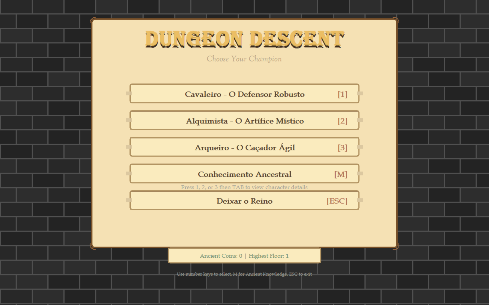
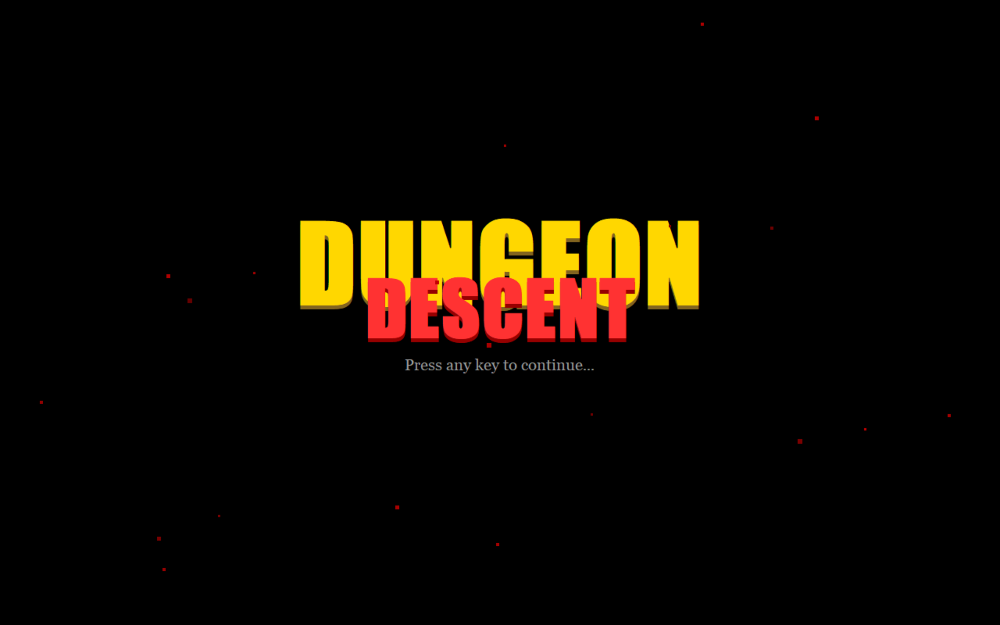
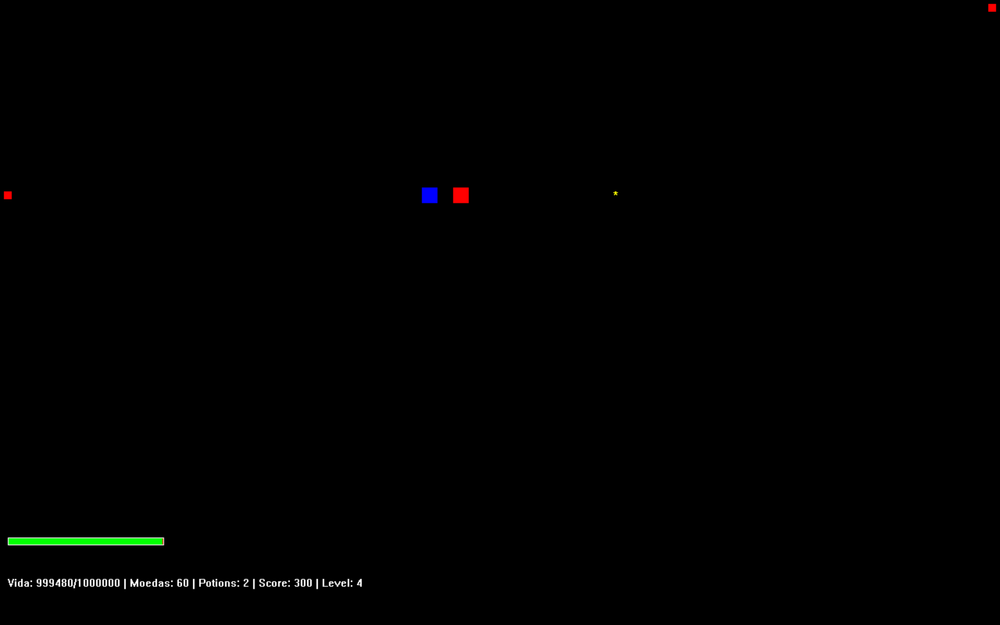

# Dungeon Descent

**A dungeon-crawler prototype developed in C with the Windows API — no game engine.**

Dungeon Descent is a personal game-development experiment built with **C, Win32 API, and GDI**. I created it to explore native rendering, real-time input, combat, character classes, and progression through a playable Windows application.

This is an **early prototype**, not a finished game. Some features are incomplete, and the Knight's attributes were deliberately increased for a live demonstration; they do not represent the final balance.

## Screenshots

### 01 / Character selection

*Choose between three character classes and access the progression menu.*

### 02 / Title screen

*The opening screen of the original prototype.*

### 03 / Early gameplay

*An early gameplay scene. Visuals and mechanics are still experimental.*

## Download

[**Dungeon Descent — Prototype v0.1 (Windows x64)**](https://github.com/pie030/Dungeon-Descent/releases/tag/v0.1.0-demo)

Download `Dungeon-Descent.exe` from the release page. The author has tested the executable on Windows, but compatibility with a clean Windows installation has not been independently verified. The executable is not digitally signed.

## Controls

| Action | Key |
| --- | --- |
| Move | `W` `A` `S` `D` or arrow keys |
| Shoot | `I` `J` `K` `L` or numpad `8` `4` `2` `6` |
| Use health potion | `Space` |
| Poison pool (Alchemist) | `P` |

## Technical notes

- **Language:** C
- **Platform:** Windows x64
- **Rendering and window management:** Win32 API / GDI
- **Systems:** menus, combat, progression, abilities, and saving (prototype implementations)
- **Status:** experimental; unfinished features and bugs may remain
- **Source code:** not publicly available at this stage

The screenshots above are from the actual executable. This repository preserves the project as a playable prototype rather than presenting it as a finished release.
